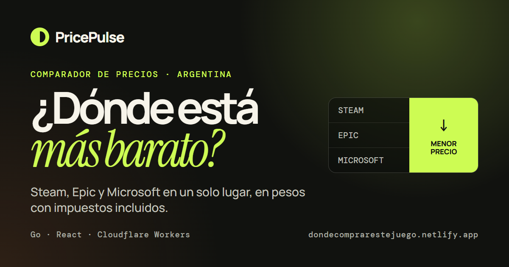
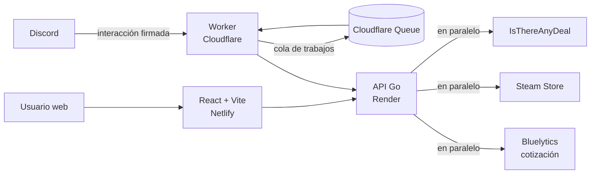

<div align="center">

<a href="https://dondecomprarestejuego.netlify.app/"></a>

# PricePulse

**¿Dónde está más barato este juego?** Compará Steam, Epic y Microsoft Store en un solo lugar, en pesos y con impuestos incluidos.

[](https://github.com/LorenteFacundo/game-price-comparator/actions/workflows/ci.yml)


[](LICENSE)

### [Probar la demo](https://dondecomprarestejuego.netlify.app/) · [Agregar el bot a Discord](https://discord.com/oauth2/authorize?client_id=1548062341973942315) · [Documentación del bot](discord-worker/README.md)

</div>

> **In English:** PricePulse tells you where a video game is cheapest in Argentina. A Go API queries IsThereAnyDeal, Steam and an exchange-rate API in parallel, ranks deals by popularity and reviews, and converts USD prices to ARS including taxes. It ships with a React frontend, a Discord bot running on Cloudflare Workers with a job queue, and a CI pipeline with unit and end-to-end tests.

---

## El problema

En Argentina, el precio que ves en una tienda no es el que pagás: algunas tiendas publican en dólares, otras en pesos, y a la tarjeta se le suman impuestos. Comparar un mismo juego entre Steam, Epic y Microsoft implica abrir tres pestañas y hacer cuentas. PricePulse lo resuelve en una búsqueda.

## Qué hace

- **Busca un juego** y muestra el precio en cada tienda, ordenado del más barato al más caro.
- **Convierte USD a ARS con impuestos** usando la cotización oficial actualizada; los precios publicados en pesos no se reconvierten.
- **Ofertas curadas** de Steam, Epic y Microsoft, rankeadas por popularidad, reseñas y jugadores activos, sin perder los juegos gratis.
- **Populares y más jugados** de Steam, con su precio y la tienda donde están más baratos.
- **Detecta precios sospechosos**: si una tienda publica un precio absurdamente bajo (suele ser otro producto mal asociado), se muestra con un aviso pero no gana como "más barato".
- **Favoritos e historial** guardados sólo en tu navegador; no hay cuentas.
- **Bot de Discord** con la misma lógica que la web.

## Bot de Discord

[Agregalo a tu servidor](https://discord.com/oauth2/authorize?client_id=1548062341973942315). No pide permisos de administrador.

| Comando | Qué hace |
|---|---|
| `/precio juego:Hades` | Precio en cada tienda y cuál es la más barata, con botones para recorrer resultados |
| `/ofertas` | Las mejores ofertas del momento, en pesos con IVA |
| `/gratis` | Juegos gratis por tiempo limitado y hasta cuándo |
| `/populares` | Los más vendidos de Steam con su precio y dónde están más baratos |
| `/ayuda` | Explica los comandos |

## Arquitectura



## Decisiones técnicas

| Decisión | Por qué |
|---|---|
| **Consultas en paralelo con timeout** | `/api/deals` combina 5 fuentes con goroutines y un contexto de 15 s: la respuesta tarda lo que la fuente más lenta, no la suma de todas. |
| **Degradación elegante** | Si una fuente falla, la API devuelve lo que sí obtuvo y avisa qué faltó. Si la cotización no responde, usa la última conocida (hasta 6 h) y la marca como desactualizada. |
| **Nunca mezclar monedas** | El ranking sólo compara precios en monedas convertibles conocidas; un precio en USD jamás se interpreta como ARS. |
| **Caché en memoria acotada** | TTL de 5 min y máximo 500 entradas: protege las cuotas de las APIs externas sin necesitar Redis en un plan gratuito. |
| **Rate limiting por IP + tope global** | Token bucket propio (sin dependencias). El tope global protege la cuota de ITAD aunque alguien rote IPs. |
| **Observabilidad sin datos personales** | Cada request tiene un `X-Request-ID`, se registran ruta, estado y duración, pero nunca los términos buscados. |
| **Bot asíncrono** | Discord exige responder en 3 s: el Worker verifica la firma Ed25519, responde "pensando…" y procesa la búsqueda desde una cola. |
| **Reseñas en lote** | Las reseñas de Steam de todas las ofertas se piden en una sola consulta a `IStoreBrowseService`, la API que usa la propia tienda. |
| **Datos de terceros sin alterar** | Los precios se muestran tal como los publica cada fuente; los valores sospechosos se señalan, nunca se corrigen a mano. |

## Stack

- **Backend:** Go 1.25 (`net/http`, sin framework), desplegado en Render.
- **Frontend:** React 19 + Vite, CSS propio, desplegado en Netlify.
- **Bot:** Cloudflare Workers + Queues, desplegado automáticamente desde CI.
- **Calidad:** tests unitarios en Go y Node, tests end-to-end con Playwright, ESLint, `go vet`, Dependabot y GitHub Actions.

## Ejecutar localmente

Requisitos: Go 1.25+, Node 22+ y una clave gratuita de [IsThereAnyDeal](https://isthereanydeal.com/dev/app/).

```bash
# 1. Backend
cp backend/.env.example backend/.env   # completá ITAD_API_KEY
cd backend && go run .

# 2. Frontend (en otra terminal)
cd frontend && npm install && npm run dev
```

Abrí `http://localhost:5173`. Para apuntar a un backend remoto, configurá `VITE_API_URL` en `frontend/.env`.

## Tests

```bash
cd backend && go vet ./... && go test ./...
cd frontend && npm run lint && npm run build && npm run test:ui
cd discord-worker && npm ci && npm run lint && npm test
```

## API

| Endpoint | Descripción |
|---|---|
| `GET /api/search?q=hades` | Precios de un juego en todas las tiendas, ordenados y con el mejor precio. |
| `GET /api/deals?limit=12` | Ofertas destacadas, gratis y mayores descuentos. |
| `GET /api/discover` | Populares y más jugados de Steam, con precio en Steam y el más barato. |
| `GET /api/health` | Estado, versión y uptime (no consume cuotas externas). |

## Operación en producción

- Monitor HTTP sobre `/api/health` (ver [docs/MAINTENANCE.md](docs/MAINTENANCE.md)).
- Los usuarios pueden reportar un precio incorrecto desde la tarjeta; se crea un Issue con el contexto completo.
- Rutina semanal y mensual, procedimiento ante incidentes y publicación de versiones documentados en [MAINTENANCE.md](docs/MAINTENANCE.md).

## Próximos pasos

- Historial de precios con snapshots periódicos (servicio *ingestor* separado).
- Alertas de bajada de precio por Discord.

## Fuentes de datos

- Precios y ofertas: [IsThereAnyDeal API](https://docs.isthereanydeal.com/) y [Steam](https://store.steampowered.com/).
- Cotización del dólar: [Bluelytics](https://bluelytics.com.ar/).

PricePulse no está afiliado a IsThereAnyDeal, Valve, Epic Games ni Microsoft. Los precios son orientativos: verificá siempre el total en la tienda antes de comprar.

## Autor

**Facundo Lorente** · Desarrollador backend · Buenos Aires

[GitHub](https://github.com/LorenteFacundo) · [LinkedIn](https://www.linkedin.com/in/facundo-lorente-692206230)

## Licencia

[MIT](LICENSE)
